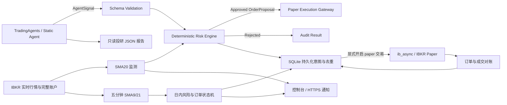

# Agent Quant System

面向美股的投研、日线监测与日内模拟交易项目。以本工程为主，迁入 `ibkr-intraday-master` 的五分钟均线策略、部分成交保护、撤单屏障和日内风险控制，统一使用 `ib_async` 与 SQLite；原 LEAN 工程保持不变，新运行路径不依赖 LEAN、Docker 或 Windows 启动器。

TradingAgents 只生成结构化建议和研究报告，不能直接修改风险参数或下单。自动执行使用确定性策略，日线和日内模式互斥，不是 LLM 自主交易。

> 当前版本只支持本地演示与 IBKR 模拟账户，禁止实盘。监测默认只读；真实券商接入仍需在你的 IB Gateway、模拟账户和行情权限下联调。代码和示例不构成投资建议。

## 架构



Agent 无权修改置信度阈值、单标的仓位、单笔名义金额、总敞口和日亏损熔断线。Ticker 不一致、低置信度、超仓位以及无持仓卖出都会在执行前拒绝。

## 快速开始

项目使用 Python 3.12 和 [uv](https://docs.astral.sh/uv/)。

```bash
cd /home/voyah/workspace/free/agent-quant-system
uv sync --extra dev
uv run agent-quant doctor
uv run agent-quant demo --ticker AAPL --price 200 --cash 10000
uv run pytest
```

`demo` 经过信号校验、风控和本地假成交，并输出 JSON；它不是券商连接，也不维护资金账本。尝试一个应被拒绝的信号：

```bash
uv run agent-quant demo --ticker AAPL --confidence 0.30
```

## 启用 TradingAgents

在 Linux / Bash 中执行准备脚本，无需先激活虚拟环境：

```bash
cd /home/voyah/workspace/free/agent-quant-system
bash setup_research.sh
```

脚本自动定位项目目录，检查 Git，查找或通过当前用户的 pip 安装 uv；缺少虚拟环境时通过 uv 安装 Python 3.12 并创建 `.venv`。该环境安装锁定的项目依赖及 dev、backtest、monitor 扩展。投研使用独立的 `.venv-research`，联合安装本工程的 monitor 扩展和 `requirements-agent.txt` 中固定版本的 TradingAgents，随后检查两个环境的依赖兼容性。

独立环境是必要的：TradingAgents v0.7.0 要求 `pandas>=3.0.6`，现有回测环境要求 `pandas<3`，不能直接混装。项目代码仍是同一个 Python 包，两套环境均使用当前源码；投研环境不安装 backtest 扩展。已有不兼容的虚拟环境不会被自动删除；若系统没有 Git、Python/pip 或禁止用户级安装，按错误提示准备这些系统工具后重试，脚本不会使用 sudo。

脚本仅在不存在时从模板创建 `.env`，将文件权限收紧到 `600`，并把缺失或 `static` 的研究提供者设为 `tradingagents`。已有密钥、模型选择、账户及交易参数保持不变；不会开启任何交易开关，不会安装尚未使用的 NautilusTrader，不会请求模型或连接券商。

首次运行通常以退出码 `2` 提示还需配置密钥。这表示安装阶段完成但配置未就绪，不是安装失败。在本机编辑 `.env`，填写 `OPENAI_API_KEY`；使用其他模型提供商时设置其对应密钥和 `AQS_LLM_PROVIDER`、`AQS_QUICK_THINK_LLM`、`AQS_DEEP_THINK_LLM`。不要把密钥发到聊天或提交到 Git。

配置完成后运行只读检查，再开始分析：

```bash
bash setup_research.sh --check
uv run --no-project --env-file .env .venv-research/bin/agent-quant analyze --ticker AAPL --price 200 --cash 10000
```

`--check` 不安装依赖、不创建或修改配置；退出码 `0` 表示本地检查通过，`1` 表示准备过程出错，`2` 表示配置、凭据或依赖仍需处理。检查仅确认密钥非空，不验证其有效性、模型权限或行情可用性。Shell 中已导出的同名变量优先于配置文件，旧值可能需要先 `unset`。上述命令通过 `--env-file .env` 加载模型密钥，无需手工 `source`；`--no-project` 避免同步主工程环境，显式执行投研环境的 CLI。若 uv 未加入 PATH，可使用准备脚本最后输出的完整路径命令。

`200` 只是示例价格，不是实时行情。运行 `analyze` 会消耗模型额度，但不依赖 IBKR，只进入本地演示网关。

传给 `--price` 的值必须来自你信任的行情快照；系统不会采用 LLM 文本中的价格下单。TradingAgents 的建议仍只进入本地演示网关。上游不提供置信度时按 `0` 处理，不默认赋予下单资格；评级必须精确匹配，`REVIEW` 不交易。

## IBKR 行情监测与模拟交易

此路径直接使用 `ib_async`，不依赖尚未接线的 NautilusTrader。仅支持 USD 基础币种、现金非负、无空头的股票账户，使用整股、仅常规时段有效的订单。以下默认描述 `daily` 日线模式；日内模式的保护单和退出规则见后文。请使用专用模拟账户，不要与其他机器人或人工交易混用。

```bash
uv sync --extra dev --extra backtest --extra monitor --no-progress
cp -n .env.example .env
```

在本机登录 **IB Gateway 或 TWS 的 Paper Trading 模式**，启用 API 连接，只允许受信任的本机地址。Gateway 默认模拟端口为 `4002`，TWS 为 `7497`。只监测时保持 TWS 的 API Read-Only 选项开启；提交模拟单前才关闭该选项。登录密码不要写进本项目。

在 `.env` 设置真实的模拟账户 ID、端口和股票池：

```dotenv
AQS_ENVIRONMENT=paper
AQS_LIVE_TRADING_ENABLED=false
AQS_IB_ACCOUNT_ID=DU替换为模拟账户数字
AQS_IB_GATEWAY_PORT=4002
AQS_IB_CLIENT_ID=71
AQS_MONITOR_SYMBOLS=AAPL,MSFT,NVDA,AMZN,GOOGL
AQS_PAPER_TRADING_ENABLED=false
```

账户 ID 必须与券商返回的账户一致，连接中不能出现非 `DU` 账户。端口与前缀是防误用措施，不替代操作员确认 Paper 登录。API 需要这些股票的**实时行情权限**；延迟、冻结、缺失、过期或价差异常行情不会触发下单。

先做单轮只读检查，再持续监测：

```bash
uv run --extra monitor agent-quant monitor --once
uv run --extra monitor agent-quant monitor
```

仅在完成账户、行情和订单回报核验后，将 `.env` 中 `AQS_PAPER_TRADING_ENABLED=true`，并显式传入第二重开关：

```bash
uv run --extra monitor agent-quant monitor --execute
```

- 信号取最近已完成的 20 个 NYSE 交易日日线；前日收盘高于 SMA20 时目标仓位默认 `5%`，否则退出已有仓位。`confidence=1` 表示确定性规则，不是预测准确率。
- 只在常规交易时段评估。每轮最多提交一个新订单，同账户、同交易日、同股票、同策略版本只允许一个执行意图；拒单或撤单也不会当天自动重新尝试该意图。
- 账户使用完整持仓、现金、已结算资金、可用资金和券商当日 PnL。持仓与净资产明显不一致、数据不完整时停止该轮；日亏损阈值只限制新增风险，仍允许减仓。
- 先持久化意图，再请求券商。接受请求不等于成交；订单状态、累计成交和执行 ID 都经对账更新。未结订单、其他客户端订单、部分成交或 `UNKNOWN` 阻止新单。
- 断线会有限重连，但不会重发未知结果的订单。连续三轮异常会持久化停止。状态数据库不可删除、换路径或复制后并行启动以绕过去重；同一机器同账户有额外进程锁，多主机部署不受该锁保护。
- 默认向控制台输出 JSON 事件并写入 SQLite。可选 `AQS_NOTIFICATION_WEBHOOK=https://...` 接收 JSON POST；失败留在 outbox 待后续重试，可能重复投递，接收端应按 `event_id` 去重。通知不可达时不继续开启新一轮交易。

### 停止、状态与恢复

```bash
uv run --extra monitor agent-quant monitor-status
uv run --extra monitor agent-quant monitor-stop
uv run --extra monitor agent-quant monitor-resume --confirm-reviewed
```

`monitor-stop` 写入配置的停止文件与数据库停止标记。日线模式在**执行模式连接有效时**尝试取消本客户端的 `aqs-` 订单；日内模式只取消未完成入场，保留已有保护止损。它不平仓、不取消其他程序订单，也不保证断线时已经撤单。紧急情况下须直接在 TWS 核对。Ctrl-C 同样保留停止标记。

`monitor-status` 仅展示本地记录，不代表即时券商状态。日线停止后可运行 `monitor --execute --once` 进行撤单与对账；日内执行不允许 `--once`，需运行持续监测命令。只读模式不会撤单。存在未决记录时禁止恢复。IBKR 历史订单接口有时间范围限制；崩溃发生在持久化之后、发送之前，或旧订单不可查询时，`UNKNOWN` 可能无法自动解除，需人工核验及审计处理，不能删除数据库后重试。

`doctor` 只检查配置和依赖，不证明连接或行情正常。当前离线测试覆盖了正常与异常分支，但**尚未完成本机 IBKR 外部联调，更不支持真实资金运行**。先只读运行，再小额模拟试单并检查 TWS、SQLite 和实际成交回报。

NautilusTrader 仍是未来可选执行框架；原 `requirements-execution.txt` 保留，但它不是上述 `monitor` 命令的执行后端。

## 合并后的日内模式

在 `.env` 中设置以下变量，其余账户、行情权限和模拟盘限制与日线模式一致。**使用单独的状态库，不要把已有日线库改名、删除或当作日内库使用。** 停止、状态、恢复和平仓命令必须使用同一份配置。

```dotenv
AQS_STRATEGY_MODE=intraday
AQS_INTRADAY_SYMBOLS=SPY,QQQ
AQS_MONITOR_STATE_PATH=data/intraday.sqlite3
AQS_MONITOR_STOP_PATH=data/INTRADAY_STOP
AQS_PAPER_TRADING_ENABLED=false
```

先启动只读监测：

```bash
uv run --extra monitor agent-quant monitor --mode intraday --once
uv run --extra monitor agent-quant monitor --mode intraday
```

完成模拟账户人工核验后，设置 `AQS_PAPER_TRADING_ENABLED=true`，再持续运行：

```bash
uv run --extra monitor agent-quant monitor --mode intraday --execute
```

| 行为 | 当前实现 |
| --- | --- |
| 信号 | 最近已完成五分钟 K 线的 SMA9/SMA21 交叉，缺失/重复数据拒绝使用 |
| 股票池 | 默认 SPY、QQQ，最多 5 个；不自动采用 LLM 推荐股票 |
| 入场窗口 | 开盘后 15 分钟至收盘前 15 分钟，使用 NYSE 日历及提前收盘时间 |
| 数量 | 整股；单股最多 10%、总敞口最多 30%、最多 3 个持仓标的，并受更严格的全局限制约束 |
| 资金 | 保留权益 5% 加固定现金缓冲；使用已结算资金；有未完成入场时不再发新入场 |
| 入场订单 | ask 上浮 2 基点、按 tick 向上取整的限价单；60 秒后请求撤销未成交部分 |
| 次数限制 | 每个已完成 K 线信号只消费一次，每日最多 10 次入场意图，拒单也计数 |
| 保护 | 每次新增累计成交数量对应一个约 0.5% 距离的止损市价单 |
| 退出 | 死叉、日亏损限制或收盘前 5 分钟触发；先撤入场与止损，确认终态后按剩余持仓发市价单 |
| 日亏损 | 默认 1%，基于当日首次有效账户快照权益，同时检查券商日 PnL；同日重启不会清零 |
| 收盘审计 | 收盘前 1 分钟及闭市时发现未结订单/持仓会记录告警，不保证一定平仓成功 |
| 异常 | 未知提交不重发；退出拒单不自动重复卖出；断线重连、对账失败需人工核验 |

日内状态机移植自原工程的风险和订单管理设计，并针对累计成交回报、`Decimal` 金额和 SQLite 原子持久化改写，不依赖原目录的 Python 导入。成交消费记录与子订单意图在同一事务中保存；发送前再保存 `INTENT`，重启不会把未知结果当作未发送。状态与订单表不一致、数据损坏时禁止恢复。

首次执行要求专用账户无已有持仓/订单。后续可以恢复本状态库跟踪的持仓和保护单，但必须与券商完整账户对账；外部持仓或订单不会被自动接管。同机账户锁防止日线和日内同时运行；不能靠换数据库路径或换主机绕过。

### 日内停止与平仓

```bash
uv run --extra monitor agent-quant monitor-stop
uv run --extra monitor agent-quant monitor-status
```

停止和 Ctrl-C **保留已建立的保护单，不自动平仓**。保护订单目前为 `DAY`，不能将停机后持仓视为隔夜受保护。执行进程不可无人值守，须在 TWS 检查实际持仓和订单。

主动退出本系统日内持仓需要显式请求，并保持或重新启动执行模式监测器：

```bash
uv run --extra monitor agent-quant monitor-flatten --confirm-paper-exit
uv run --extra monitor agent-quant monitor --mode intraday --execute
```

平仓请求允许退出逻辑跨过本地停止标记，但不能越过模拟账户限制、交易时段、未知订单或撤单确认屏障。命令返回不等于已平仓；收到成交回报并对账为零后才完成。只读进程不会完成该请求。完成后仍保持停止状态，需人工复核并运行 `monitor-resume --confirm-reviewed`；当日亏损锁定不会因此清零。

日内模式下通知失败只阻止新增入场，仍继续处理既有保护和退出。轮询默认间隔为 5 秒，但 API 请求本身还需时间；不是低延迟执行系统。保护单并非与入场原子提交，进程崩溃或网络中断可能留下未保护持仓，止损也不保证成交价格。

## 只读投研报告

保留原 `analyze` 本地演示入口，新增 `research`：从 IBKR 只读连接取得完整账户快照后断开券商连接，再调用 TradingAgents，写出独立 JSON 报告，**从不提交订单**。

```bash
bash setup_research.sh
# 在 .env 配置模型密钥、模拟账户 ID 和 Gateway/TWS 模拟端口
uv run --no-project --env-file .env .venv-research/bin/agent-quant research --ticker SPY --output reports/SPY-research.json
```

研究连接使用交易 client ID 加 100，需确保该 ID 未被其他客户端占用；报告默认不覆盖已存在文件。LLM 运行不占用交易循环，报告不自动送入日内执行，也不赋予未知置信度下单资格。模型依赖、API 权限与外部调用需要自行配置；离线测试只验证接口契约，不证明外部模型可用。

## 合并验证边界

新增离线测试覆盖了五分钟信号、提前收盘、部分成交保护、恢复去重、撤单屏障、迟到成交、未知提交、保护/退出拒单、亏损锁定、模式互斥、停止保留保护、显式平仓、通知失败及只读投研不下单。测试使用可控券商替身，不会连接券商。

**尚未完成真实分钟历史数据回测、IBKR 模拟单外部联调或策略盈利验证。** 原日线 Backtrader 报告不代表日内策略结果，原 LEAN 工程的回测/部署脚本也没有迁入或执行。合并后的项目不支持实盘，不应无人值守运行。

## 历史行情回放

独立回放使用 Backtrader 维护现金与持仓，复用本项目 `RiskEngine`，不使用无账本的本地成交替身。需要系统安装 `curl`：

```bash
uv sync --extra dev --extra backtest --no-progress
uv run --extra backtest python -m agent_quant_system.research.backtest
```

默认下载东方财富的美股前复权日线，校验最近 5 个已完成的 NYSE 交易日，另取前 20 个交易日作为均线预热。固定股票池为 AAPL、MSFT、NVDA、AMZN、GOOGL，SPY 仅作基准；任一标的行情缺失或异常都会停止，不补造数据。

初始资金为 10,000 美元。前一日收盘高于 SMA20 时目标仓位为每股 5%，否则退出，订单经本项目风控审批后于下一交易日开盘模拟成交。仅使用整股，每次成交计 5 基点佣金和 5 基点滑点（受日线高低价约束），期末按收盘价估值，不强制平仓。

这是确定性基线测试，不是 TradingAgents 决策回测，也不是 IBKR 联调证明。整股约束与信号过滤会使实际仓位低于 25%；满仓 SPY 为未扣费价格收益对照，不能直接视为同风险比较。日线不能证明盘中熔断或真实成交可行性，5 天也不足以推断长期盈利能力。

每次运行在 `reports/weekly-<时间戳>/` 保存原始响应、25 日行情 CSV、每日权益、成交、审批、JSON 汇总、Markdown 报告及 PNG 曲线。固定观察时间和行情快照可离线重放：

```bash
uv run --extra backtest python -m agent_quant_system.research.backtest \
  --as-of 2026-10-22T07:00:00+00:00 \
  --data-dir reports/weekly-20261022T082848484303Z
```

原命令 `python -m agent_quant_system.backtest` 仍可用，由兼容入口转到同一份回放实现。

## 配置

复制 `.env.example` 后调整 `AQS_` 变量。安全默认值如下：

- 环境：`paper`
- 投研：`static`
- 执行：`paper`
- 最低置信度：`0.65`
- 单标的最大权重：`10%`
- 单笔最大名义金额：`5000 USD`
- 日亏损熔断：`2%`
- 做空：关闭

真实密钥、`.env`、行情缓存、报告和交易日志均已加入 `.gitignore`。

## 目录

业务代码分为 `trading/`（交易执行）和 `research/`（投研与回测）两大目录，
配置、契约和风控作为共享层保留在包根目录。仍是同一个 Python 项目，不需要分别安装。

```text
src/agent_quant_system/
  trading/
    cli.py       监测、停止、状态、恢复与平仓命令
    intraday.py  五分钟策略、日内风险与持久化订单状态机
    ibkr.py      受限 IBKR paper 账户与订单适配
    monitor.py   日线监测、SQLite、去重、锁与通知
  research/
    cli.py       投研报告、analyze 与 demo 命令
    providers.py Static/TradingAgents 投研适配器
    service.py   投研、共享风控与本地演示执行的编排
    execution.py 本地演示成交网关，不是券商执行器
    backtest.py  历史行情回放、权益与成交报告
  config.py      共享环境配置与安全开关
  models.py      共享信号、组合、订单和回执契约
  risk.py        共享确定性交易前风控
  cli.py         统一命令注册与 doctor 环境诊断
  backtest.py    旧回测模块路径的兼容入口
tests/           两类业务与共享层的回归测试
```

`agent-quant monitor --mode intraday`、`agent-quant research` 等现有命令不变；
配置键、状态库路径和历史报告也保持不变。投研获取真实账户快照时只读复用
`trading.ibkr`，交易执行目录不导入投研实现，Agent 报告不会自动进入下单流程。

Python 内部导入路径已随目录调整，例如 `agent_quant_system.trading.intraday`
和 `agent_quant_system.research.service`。包根目录导出的 `TradingSystem`、
`agent_quant_system.research` 导出的两种投研适配器以及旧回测入口继续保留。
